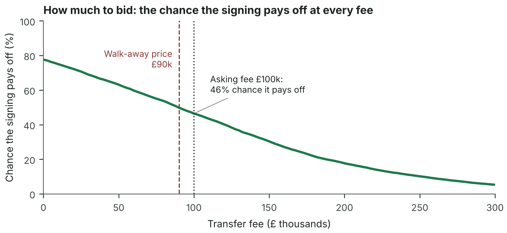
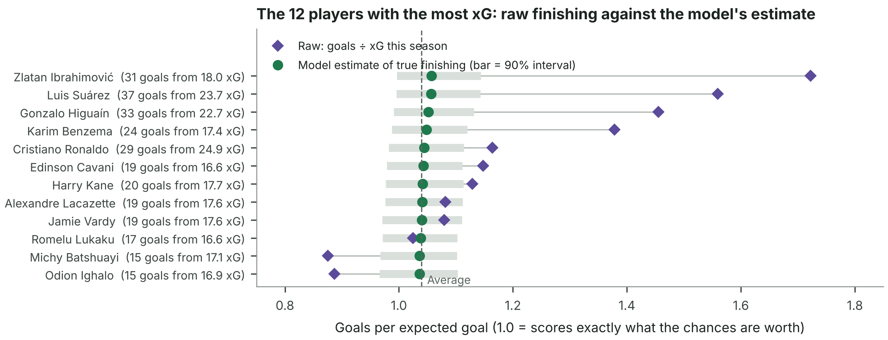
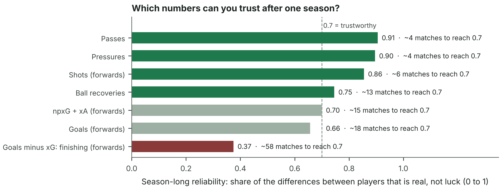
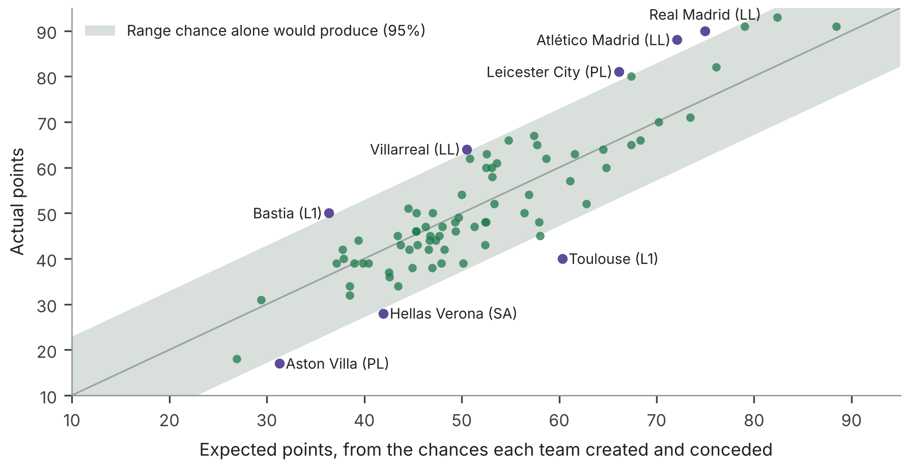
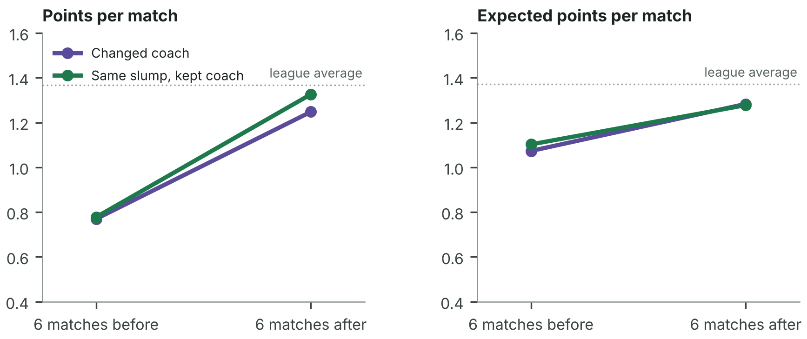
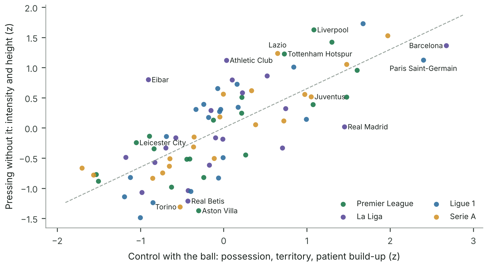
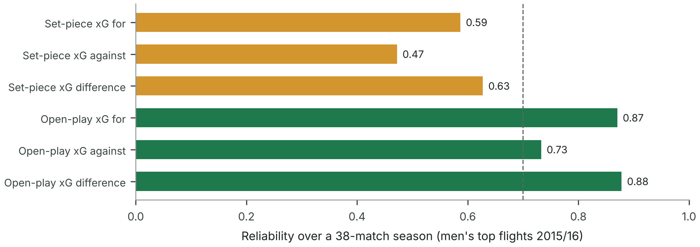

# Football decisions under uncertainty

**Ten projects on recruitment, transfer value, team and coach evaluation, game models, data quality, injury, fatigue and set pieces, built from free public event data with methods from health economics, clinical epidemiology, laboratory science and exercise physiology.**

By Joe Taylor: health economist, sport and exercise scientist and start-up co-founder, who trained as a clinical perfusion scientist in the NHS.

📊 **[A deck for every project](decks/)** (PDF, 6 to 11 slides each) &nbsp;·&nbsp; 📄 **[The original six-project portfolio](portfolio/Joe_Taylor_Football_Decisions_Portfolio.pdf)** (PDF, 16 pages)

Health systems decide every week whether a new medicine is worth its price, with incomplete evidence, a fixed budget and a lot at stake, and they've built rigorous tools for exactly that. This repository applies those tools to the decisions football clubs make. Every number and chart is produced by the code here, from raw match files, with nothing typed in by hand.

---

## The projects

| | Question | Method, and where it comes from | Data |
|---|---|---|---|
| 1 | What should we pay for a player, and how should the deal be structured? | Decision model, probabilistic analysis and value of information (health technology assessment, NICE methods) | WSL 2023/24 |
| 2 | Is a hot finisher skilled or lucky? | Bayesian hierarchical model, tested out of sample | WSL 2023/24; four men's leagues 2015/16 |
| 3 | Which numbers can we trust, and when is a change in form real? | Reliability, reference change values, false discovery rate (clinical laboratory science) | WSL 2023/24 |
| 4 | Which numbers should a shortlist be built on? | Diagnostic accuracy: ROC/AUC, sensitivity, PPV (screening-test evaluation) | Four men's leagues 2015/16 |
| 5 | How often are players injured in matches, when, and for how long? | Injury epidemiology with a correction for ascertainment bias | Four men's leagues 2015/16 |
| 6 | Do players tire, and can event data show it? | Mantel-Haenszel stratified comparison, cluster bootstrap (epidemiology) | Four men's leagues 2015/16 |
| 7 | How good is a team, really? | Observed against expected, as in risk-adjusted hospital outcomes; reliability; prognostic validation | Four men's leagues 2015/16; WSL 2018/19 to 2023/24 |
| 8 | Judging a head coach: does a mid-season change work? | Funnel plots; controlled before-and-after study with matched controls | Four men's leagues 2015/16 |
| 9 | Can event data measure a game model? | Measurement validation as for clinical questionnaires (COSMIN): reliability, construct validity, structure, responsiveness | Four men's leagues 2015/16; WSL 2018/19 to 2023/24 |
| 10 | Are set pieces a repeatable edge, and what is it worth? | Reliability, signal and noise, points per goal (cost-effectiveness framing) | Four men's leagues 2015/16; WSL 2018/19 to 2023/24 |

### 1. Appraising a signing the way NICE appraises a medicine

An illustrative target (the best forward outside the top four, asking fee £100k, a league point valued at £60k) is appraised in eight steps: a league model turning goals into points, random-effects shrinkage of her season, a Markov model of fitness and injury, 10,000 simulations, an acceptability curve, value of information and an outcomes-based deal.

- **Walk-away price £90k.** There's only a 46% chance the deal pays off at the asking price.
- **96% of the value of extra information is about her true level**, so more scouting pays and a more detailed medical adds little.
- **An outcomes-based deal of £83k up front plus £17k at 16 goals and assists** gives the seller their price only if she repeats last season, and costs the club its walk-away price on average.



Fee, wages, injury rates and the value of a point are illustrative; points per goal and her level are estimated from the data.

### 2. Finishing: skill or luck?

- In the WSL, true finishing skill varies by only about **±8%** between players, and none of the 77 players with 15+ shots can be called a genuinely better finisher on one season's evidence.
- Out of sample in four men's leagues (206 players), over-performing xG in the first half of the season **didn't predict the second half (r = −0.06)**. The quality of a player's chances did (r = 0.68).



### 3. Measurement science: which numbers to trust, and when form is real

- Passing and pressing are reliable after about 4 matches; chance quality needs about 15; **finishing needs about 58, nearly three WSL seasons**.
- Of 433 end-of-season changes in form, 28 crossed the usual 95% line, about as many as chance alone would produce (22). **Only 6 survived false-discovery control.**



### 4. Scouting numbers judged like a screening test

- As a screening test for next-half top performers, **npxG + xA scored an AUC of 0.80, against 0.69 for goals + assists**.
- A shortlist built on npxG found 59% true future top performers, against 47% for goals + assists and 20% at random.


### 5. Injuries in matches: what event data can and can't see

- **12.9 injury withdrawals per 1,000 player-hours** across 1,517 matches.
- **A recording bias hides late-match injuries.** With three substitutions, once they're used an injured player can't come off. Counting only the minutes in which an injury could be recorded, the last period has the **highest risk, 5.6 times the first 15 minutes**.
- 60% of players withdrawn injured missed their team's next league match, against 11% after a tactical substitution.


### 6. A fatigue signal in event data

- In the last period, **fresh substitutes pressed 17% more** (95% CI 14% to 20%) than the same players did as starters, in the same score state, matching what time-motion studies found with no tracking data at all.


### 7. How good is a team, really?

Expected points from every chance created and conceded (shots in the same possession combined, goals as a Poisson-binomial distribution), compared with the table the way hospitals compare observed with expected outcomes.

- Across 80 teams, points minus expected points varied by 7.6 points a season; chance alone would produce 6.6. **About 74% of the gap between the table and the chances is luck.**
- **Points need about 40 matches to measure a team reliably (0.8); expected-goal difference needs about 20.** A season of points tells you about as much as half a season of chances.
- Leicester won the 2015/16 Premier League with 81 points from chances worth 66.



### 8. Judging a head coach

- **Funnel plot:** 10 of 118 coaching spells sat outside the 95% limits, against 6 expected by chance; none outside 99.8%. All four below the lower limit were replaced that season.
- **Controlled before-and-after study of all 39 mid-season changes:** points per match went from 0.77 to 1.25 after a change, and from 0.78 to 1.33 in matched teams in the same slump that kept their coach. Effect of the change: −0.07 points per match (95% CI −0.25 to 0.12). **Most of the new-manager bounce is regression to the mean.**



### 9. Measuring a game model

Fifteen style KPIs (possession, territory, build-up, pressing, width, crossing, counter-attacks, set pieces) validated the way a clinical questionnaire is.

- **Build-up KPIs measure a team within 5 to 10 matches; pressing KPIs take 25 to 35;** counter-attack and set-piece shares are still mostly noise after a season.
- **Construct validity:** when trailing rather than leading, the same teams had 57% of the ball against 43% (every one of 80 teams moved the same way), and pressed and defended higher.
- Control with the ball and pressing without it go together (r = 0.75); a team's identity is in the gap.
- A mid-season coaching change shifted style by only 1.08 times normal six-match drift (95% CI 0.92 to 1.27).



### 10. Set pieces as an investment

- **28% of non-penalty goals** came from set pieces in four men's top flights.
- Set-piece xG difference had a season reliability of 0.63, against 0.88 for open play. Much of it follows dominance (r = 0.63 between set pieces won and open-play xG difference); attacking delivery quality is the more coachable part (reliability 0.48), defending quality mostly noise in one season (0.20).
- The gap between the best and worst set-piece teams is worth about 8 goals and 5 points a season.



---

## Data

StatsBomb (Hudl) open data: <https://github.com/hudl/open-data>. Free to use with credit to StatsBomb. The results here were produced from the repository at commit `4b73468`.

| Competition | competition_id | season_id | Used in |
|---|---|---|---|
| FA Women's Super League 2023/24 (132 matches) | 37 | 281 | Projects 1 to 3, 7, 9, 10 |
| FA Women's Super League 2018/19, 2019/20, 2020/21 | 37 | 4, 42, 90 | Projects 7, 9, 10 |
| Premier League 2015/16 | 2 | 27 | Projects 2, 4 to 10 |
| La Liga 2015/16 | 11 | 27 | Projects 2, 4 to 10 |
| Serie A 2015/16 | 12 | 27 | Projects 2, 4 to 10 |
| Ligue 1 2015/16 (377 of 380 matches in the open data) | 7 | 27 | Projects 2, 4 to 10 |

The raw data isn't stored in this repository; the build scripts read a local copy (or, for projects 1 to 6, download it).

**What public data can't do:** no tracking, GPS, training or medical data; no fees or wages. Every method here runs unchanged on a club's own event, tracking, GPS, medical and financial data.

## Run it

```bash
pip install -r requirements.txt          # Python 3.10+
git clone https://github.com/hudl/open-data.git
python run_all.py open-data/data
```

Every result is written to `output/` as JSON and PNG. The decks are built by `report/decks/build_decks.py` (Python Playwright with Chrome).

## Files

| File | What it does |
|---|---|
| `build_tables.py` | Raw events and lineups into tidy player tables per competition, with StatsBomb's second-half clock restart handled so stoppage time counts. |
| `build_tables_clock.py` | The tables projects 1 to 3 were first built on, with minutes counted on the match clock. |
| `build_team_tables.py` | Team-level tables for projects 7 to 10: every shot with possession, play pattern and game state; style KPIs per team per match, overall and by game state; set pieces taken; head coaches named for each match. |
| `common.py`, `common_team.py` | Shared helpers: exact Poisson intervals, rate ratios, Kaplan-Meier, Poisson regression, expected points, chart style. |
| `project1_3_wsl.py` | Projects 1 to 3. `python project1_3_wsl.py elapsed` re-runs them on elapsed-time minutes as a sensitivity check. |
| `project2b_finishing_men.py`, `project4_screening.py`, `project5_injury.py`, `project6_fatigue.py` | Projects 2 (men's game), 4, 5 and 6. |
| `project7_team_strength.py` | Project 7: expected points, luck in the table, reliability, prognostic validation. |
| `project8_coaches.py` | Project 8: funnel plot of coaching spells and the controlled before-and-after study. |
| `project9_game_model.py` | Project 9: KPI reliability, game-state validity, structure, style map, style twins, responsiveness. |
| `project10_set_pieces.py` | Project 10: set-piece reliability, volume against quality, what the edge is worth. |
| `report/` | Template and build script for the six-project portfolio PDF; `report/decks/` builds the ten decks. |
| `run_all.py` | Runs everything in order. |

Each method is written out in the code (numpy, scipy, pandas) rather than called from a black-box package, so every step can be read and checked.

## Sources for literature benchmarks

- Ekstrand J, Hägglund M, Waldén M. Injury incidence and injury patterns in professional football: the UEFA injury study. *Br J Sports Med* 2011;45:553-558.
- Hawkins RD, Fuller CW. A prospective epidemiological study of injuries in four English professional football clubs. *Br J Sports Med* 1999;33:196-203.
- Mohr M, Krustrup P, Bangsbo J. Match performance of high-standard soccer players with special reference to development of fatigue. *J Sports Sci* 2003;21:519-528.
- DerSimonian R, Laird N. Meta-analysis in clinical trials. *Control Clin Trials* 1986;7:177-188.
- Strong M, Oakley JE, Brennan A. Estimating multiparameter partial expected value of perfect information from a probabilistic sensitivity analysis sample. *Med Decis Making* 2014;34:311-326.
- National Institute for Health and Care Excellence. *NICE health technology evaluations: the manual* (PMG36), 2022.
- Fraser CG, Harris EK. Generation and application of data on biological variation in clinical chemistry. *Crit Rev Clin Lab Sci* 1989;27:409-437.
- Benjamini Y, Hochberg Y. Controlling the false discovery rate. *J R Stat Soc B* 1995;57:289-300.
- Mokkink LB, et al. The COSMIN checklist for assessing the methodological quality of studies on measurement properties. *Qual Life Res* 2010;19:539-549.
- Spiegelhalter DJ. Funnel plots for comparing institutional performance. *Stat Med* 2005;24:1185-1202.

## About me

- **Decision modelling and health economics.** Health Economist at Lumanity (2024 to 2026); PGCert Health Economics and Decision Modelling, University of Sheffield; co-author, *Journal of Medical Economics* (2025).
- **Sport science and physiology.** BSc Sport and Exercise Sciences and MSc Sport and Exercise Physiology, Leeds Beckett; heat acclimation research with the English Institute of Sport for the British triathlon team; Barnsley FC and Leeds Rhinos academies; UK Anti-Doping accredited advisor.
- **Clinical science.** NHS Trainee Clinical Perfusion Scientist, Oxford University Hospitals (2021 to 2024).
- **Commercial.** Co-founder of Novamint, a science-led start-up.

Contact: j.taylor1998@live.co.uk

## Licence

Code: MIT licence (see `LICENSE`). Data: StatsBomb open data, used under its own terms; please credit StatsBomb/Hudl if you publish anything built on it.
