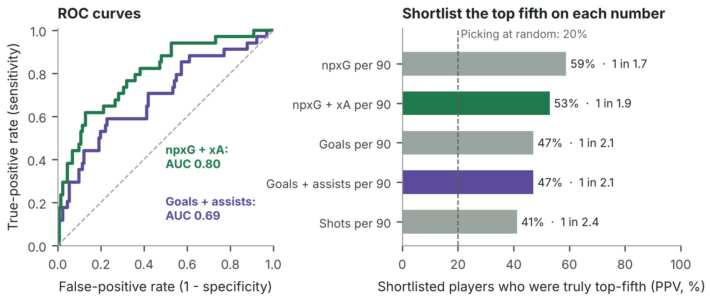
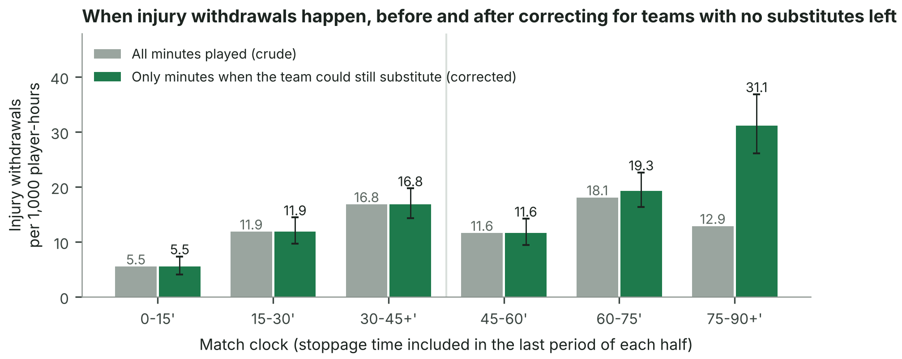
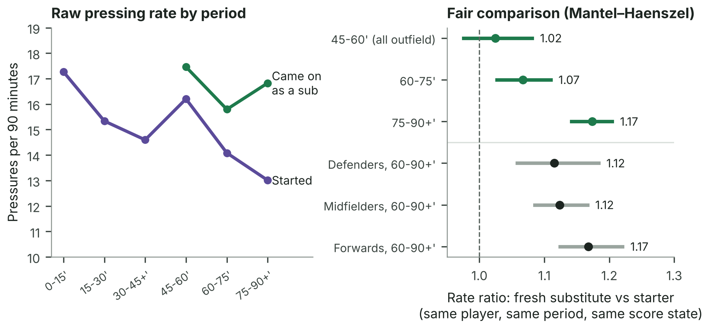

# Football decisions under uncertainty

**Six projects on recruitment, transfer value, data quality, injury and fatigue, built from free public event data with methods from health economics, clinical epidemiology, laboratory science and exercise physiology.**

By Joe Taylor: health economist, sport and exercise scientist, former NHS clinical scientist and start-up co-founder.

📄 **[Read the portfolio (PDF, 16 pages)](portfolio/Joe_Taylor_Football_Decisions_Portfolio.pdf)**

Health systems decide every week whether a new medicine is worth its price, with incomplete evidence, a fixed budget and a lot at stake, and they've built rigorous tools for exactly that. This repository applies those tools to the decisions football clubs make every week. Every number and chart in the portfolio is produced by the code here, from raw match files, with nothing typed in by hand.

---

## The projects

| | Question | Method, and where it comes from | Data |
|---|---|---|---|
| 1 | What should we pay for a player, and how should the deal be structured? | Decision model, probabilistic analysis and value of information (health technology assessment, NICE methods) | Women's Super League 2023/24 |
| 2 | Is a hot finisher skilled or lucky? | Bayesian hierarchical model (small-area disease rates), tested out of sample | WSL 2023/24 and four men's leagues 2015/16 |
| 3 | Which numbers can we trust, and when is a change in form real? | Reliability, reference change values, false discovery rate (clinical laboratory science) | WSL 2023/24 |
| 4 | Which numbers should a shortlist be built on? | Diagnostic accuracy: ROC/AUC, sensitivity, PPV (screening-test evaluation) | Four men's leagues 2015/16 |
| 5 | How often are players injured in matches, when, and for how long? | Injury epidemiology: incidence rates, Poisson regression, Kaplan–Meier with a comparison group | Four men's leagues 2015/16 |
| 6 | Do players tire, and can event data show it? | Mantel–Haenszel stratified comparison with a cluster bootstrap (epidemiology) | Four men's leagues 2015/16 |

### 1. Appraising a signing the way NICE appraises a medicine

An illustrative target (the best forward outside the top four, asking fee £100k, a league point valued at £60k) is appraised in eight steps: a league model turning goals into points, random-effects shrinkage of her season, a Markov model of fitness and injury, 10,000 simulations, an acceptability curve, value of information and an outcomes-based deal.

- **Walk-away price £92k.** There's only a 47% chance the deal pays off at the asking price.
- **96% of the value of extra information is about her true level**, so more scouting pays and a more detailed medical adds little.
- **An outcomes-based deal of £86k up front plus £14k at 16 goals and assists** gives the seller their price only if she repeats last season, and costs the club its walk-away price on average.


Fee, wages, injury rates and the value of a point are illustrative; points per goal and her level are estimated from the data. Every input and its basis is listed on page 14 of the portfolio.

### 2. Finishing: skill or luck?

Each player's goals follow his expected goals (xG) times a true finishing multiplier, and a Bayesian hierarchical model estimates how much those multipliers really vary.

- In the WSL, true finishing skill varies by only about **±8%** between players, and none of the 77 players with 15+ shots can be called a genuinely better finisher on one season's evidence.
- Out of sample in four men's leagues (206 players), over-performing xG in the first half of the season **didn't predict the second half (r = −0.06)**. The quality of a player's chances did (r = 0.68).


### 3. Measurement science: which numbers to trust, and when form is real

The two checks a clinical lab runs before acting on a test result: is it reliable, and is the change bigger than normal variation?

- Passing and pressing are reliable after about 4 matches; chance quality needs about 14; **finishing needs about 64, nearly three seasons**.
- Of 430 end-of-season changes in form across the league, 29 crossed the usual 95% line, about as many as chance alone would produce (22). **Only 6 survived false-discovery control.**


### 4. Scouting numbers judged like a screening test

A chronological split: each test uses a team's first 19 league matches, the outcome its last 19. The cohort is 165 attacking players with 900+ minutes in each half of the season.

- As a screening test for next-half top performers, **npxG + xA scored an AUC of 0.80, against 0.69 for goals + assists**.
- A shortlist built on npxG found 59% true future top performers, against 47% for goals + assists and 20% at random.



### 5. Injuries in matches: what event data can and can't see

A retrospective cohort of 42,095 appearances (52,946 player-hours) in 1,517 matches.

- **12.9 injury withdrawals per 1,000 player-hours**, about half the time-loss match injury rate in UEFA's surveillance study: event data sees the injuries that stop a player finishing.
- **A recording bias hides late-match injuries.** In 2015/16 teams had three substitutions, and once they're used an injured player can't come off, so the injury never reaches the data. Counting only the minutes in which an injury *could* be recorded, the last period of the match has the **highest risk, 5.6 times the first 15 minutes**, and risk rises 65% every 15 minutes within each half.
- 60% of players withdrawn injured missed their team's next league match, against 11% after a tactical substitution.



### 6. A fatigue signal in event data

Each player is compared only with himself, in the same 15-minute period and the same score state, as a fresh substitute and as a starter.

- In the last period, **fresh substitutes pressed 17% more** (95% CI 14% to 20%) than the same players did as starters, and the gap grows the longer the starter has played. That matches what time-motion studies of high-intensity running found, here with no tracking data at all.
- Without the matching, 38% of the raw gap is explained by who comes on and the score, not fatigue.



---

## Data

StatsBomb (Hudl) open data: <https://github.com/hudl/open-data>. Free to use with credit to StatsBomb. The results here were produced from the repository at commit `4b73468`.

| Competition | competition_id | season_id | Used in |
|---|---|---|---|
| FA Women's Super League 2023/24 (131 of 132 matches with events; all 132 results) | 37 | 281 | Projects 1–3 |
| Premier League 2015/16 | 2 | 27 | Projects 2, 4–6 |
| La Liga 2015/16 | 11 | 27 | Projects 2, 4–6 |
| Serie A 2015/16 | 12 | 27 | Projects 2, 4–6 |
| Ligue 1 2015/16 (377 of 380 matches in the open data) | 7 | 27 | Projects 2, 4–6 |

The raw data isn't stored in this repository; the build scripts download it or read a local copy.

**What public data can't do:** no tracking, GPS, training or medical data; no fees or wages. The men's seasons are from 2015/16, the most recent free men's seasons with every match. Every method here runs unchanged on a club's own event, tracking, GPS, medical and financial data.

## Run it

```bash
pip install -r requirements.txt          # Python 3.10+
# fastest: clone the open data and point at it
git clone https://github.com/hudl/open-data.git
python run_all.py open-data/data
# or read straight from GitHub (slower)
python run_all.py
```

Rebuilding the PDF also needs Node.js with Playwright (`npm i playwright`) and the Inter font. Everything else runs without it, and every result is written to `output/` as JSON and PNG.

## Files

| File | What it does |
|---|---|
| `build_tables.py` | Raw events and lineups → tidy tables per competition: appearances with on/off times, 15-minute bins, shots with xG, substitutions with reason, injury withdrawals, pressures, squads, goals. Handles StatsBomb's second-half clock restart so stoppage time counts. |
| `build_tables_clock.py` | The tables projects 1–3 were first built on, with minutes counted on the match clock. |
| `common.py` | Shared helpers: exact Poisson intervals, rate ratios, Kaplan–Meier, Poisson regression, chart style. |
| `data_summary.py` | The data table in the portfolio. |
| `project1_3_wsl.py` | Projects 1–3. `python project1_3_wsl.py elapsed` re-runs them on elapsed-time minutes as a sensitivity check (walk-away price £94k instead of £92k; no conclusion changes). |
| `project2b_finishing_men.py` | Project 2 in the men's game, with the out-of-sample check. |
| `project4_screening.py` | Project 4. |
| `project5_injury.py` | Project 5. |
| `project6_fatigue.py` | Project 6. |
| `report/` | Template and build script for the portfolio PDF. |
| `run_all.py` | Runs everything in order. |

Each method is written out in the code (numpy, scipy, pandas) rather than called from a black-box package, so every step can be read and checked.

## Sources for literature benchmarks

- Ekstrand J, Hägglund M, Waldén M. Injury incidence and injury patterns in professional football: the UEFA injury study. *Br J Sports Med* 2011;45:553–558.
- Hawkins RD, Fuller CW. A prospective epidemiological study of injuries in four English professional football clubs. *Br J Sports Med* 1999;33:196–203.
- Argibay-González JC, et al. Analysis of injury patterns in men's football between the English League and the Spanish League. *Int J Environ Res Public Health* 2022;19:11296.
- Mohr M, Krustrup P, Bangsbo J. Match performance of high-standard soccer players with special reference to development of fatigue. *J Sports Sci* 2003;21:519–528.
- DerSimonian R, Laird N. Meta-analysis in clinical trials. *Control Clin Trials* 1986;7:177–188.
- Strong M, Oakley JE, Brennan A. Estimating multiparameter partial expected value of perfect information from a probabilistic sensitivity analysis sample. *Med Decis Making* 2014;34:311–326.
- National Institute for Health and Care Excellence. *NICE health technology evaluations: the manual* (PMG36), 2022.
- Fraser CG, Harris EK. Generation and application of data on biological variation in clinical chemistry. *Crit Rev Clin Lab Sci* 1989;27:409–437.
- Benjamini Y, Hochberg Y. Controlling the false discovery rate. *J R Stat Soc B* 1995;57:289–300.

## About me

- **Decision modelling and health economics.** Health Economist at Lumanity (2024–2026); PGCert Health Economics and Decision Modelling, University of Sheffield; co-author, *Journal of Medical Economics* (2025).
- **Sport science and physiology.** BSc Sport and Exercise Sciences and MSc Sport and Exercise Physiology, Leeds Beckett; heat acclimation research with the English Institute of Sport for the British triathlon team; Barnsley FC and Leeds Rhinos academies; UK Anti-Doping accredited advisor.
- **Clinical science.** NHS Trainee Clinical Perfusion Scientist, Oxford University Hospitals (2021–2024).
- **Commercial.** Co-founder of Novamint, a science-led start-up.

Contact: j.taylor1998@live.co.uk

## Licence

Code: MIT licence (see `LICENSE`). Data: StatsBomb open data, used under its own terms; please credit StatsBomb/Hudl if you publish anything built on it.
